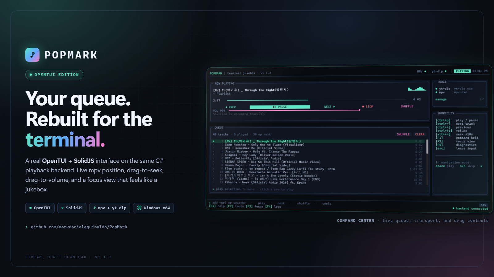
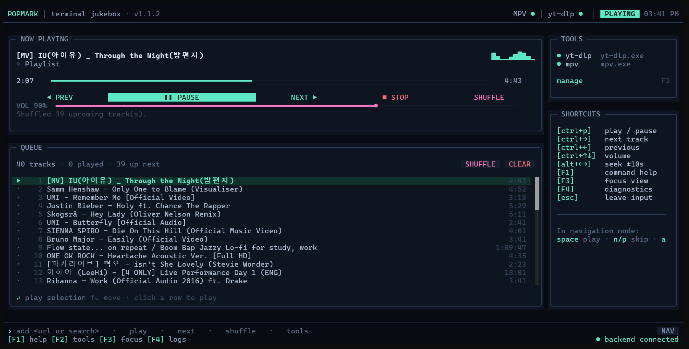
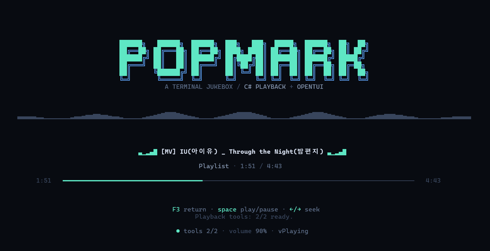

<p align="center">
  
</p>

<p align="center">
  <strong>Your YouTube music queue, in the terminal.</strong><br>
  PopMark expands videos and playlists with <code>yt-dlp</code>, streams audio through
  <code>mpv</code>, and renders a modern terminal interface with OpenTUI + SolidJS.
</p>

<p align="center">
  <a href="#quick-start">Quick Start</a> ·
  <a href="#controls">Controls</a> ·
  <a href="docs/installation.md">Installation</a> ·
  <a href="docs/configuration.md">Configuration</a> ·
  <a href="docs/user-guide.md">User Guide</a> ·
  <a href="docs/troubleshooting.md">Troubleshooting</a>
</p>

PopMark is a terminal music queue for YouTube videos and playlists. Paste a link or
type a search, and it resolves the tracks, keeps a queue, and plays them through `mpv`.
The queue survives restarts, playback advances automatically, and the current posi-
tion is read live from `mpv`.

The interface is a real [OpenTUI](https://opentui.com) application built with SolidJS.
The C# backend still owns playback, MPV IPC, YouTube resolution, queue persistence, and
tool management; the frontend talks to it over a small JSON protocol.

## Preview

### Command Center



The queue, live progress, transport controls, volume slider, tool health, and shortcuts.
Click a row to play it; drag the progress bar or volume slider.

### Focus View



Press <kbd>F3</kbd> for the large now-playing view. It is a playback surface, not a
second command input: printable keys are ignored, while playback and navigation
shortcuts still work. A sparse, dim starfield shimmers behind the content.

## Quick Start

### Portable release

Download the latest portable release from
[Releases](https://github.com/markdanielaguinaldo/PopMark/releases), extract it, and run
`PopMark.exe`. The portable build includes its own Bun runtime and OpenTUI assets, so
you do not need .NET or Bun installed.

You still need `yt-dlp` and `mpv`; PopMark can install both into
`%LOCALAPPDATA%\PopMark\tools` without administrator rights.

### Android (Termux)

Phones can run the full interface inside Termux using a Debian proot distro,
because .NET and Bun need glibc rather than Android's Bionic libc. Build the ARM64
package on a desktop:

```powershell
.\scripts\build-linux.ps1 -Runtime linux-arm64
```

Copy the archive to the phone and get `scripts/termux-install.sh` there (clone the
repo, or copy that one file). The installer can also download the release asset
itself, so from Termux you can skip the copy entirely:

```bash
bash scripts/termux-install.sh \
  https://github.com/markdanielaguinaldo/PopMark/releases/download/termux-1.1.2/PopMark-1.1.2-OpenTUI-linux-arm64-portable.tar.gz
```

Otherwise, in Termux:

```bash
pkg install -y proot-distro pulseaudio
bash scripts/termux-install.sh ~/storage/downloads/PopMark-1.1.2-OpenTUI-linux-arm64-portable.tar.gz
popmark
```

Touch works: tap the prompt to type, tap rows and sliders, and use the
HELP/TOOLS/FOCUS/LOGS/THEME/QUIT buttons in the footer. See
[Android / Termux](docs/termux.md) for audio setup, wake locks, and troubleshooting.

### Build from source

Requirements are installed automatically by the bootstrap on a fresh Windows x64 machine.

```powershell
git clone https://github.com/markdanielaguinaldo/PopMark.git
cd PopMark
.\install.cmd
```

`install.cmd` runs `scripts/install.ps1`, which:

- installs the .NET 9 SDK if no compatible SDK is present,
- installs Bun if it is missing or older than 1.3.14,
- runs `bun install` for the OpenTUI workspace,
- builds the self-contained portable package,
- installs managed `yt-dlp` and `mpv` if they are missing,
- installs the `popmark` command.

For unattended use:

```powershell
.\install.cmd /nopause -SkipPlaybackTools
```

Manual build, if you already have .NET 9 and Bun:

```powershell
dotnet build .\PopMark.sln --configuration Release
dotnet run --project .\PopMark\PopMark.csproj
```

The C# launcher starts the OpenTUI frontend automatically. To run the frontend directly:

```powershell
cd ui
bun install
bun run start
```

### Install the `popmark` command

After building the portable package or the solution, install terminal shims:

```powershell
.\scripts\install-commands.ps1
```

The script writes `popmark.cmd`, `popmark-release.cmd`, and `popmark-debug.cmd` into
`%USERPROFILE%\.local\bin`, adds that folder to your user `PATH` if needed, and points
each command at the matching local build. Open a new terminal, then run:

```powershell
popmark            # portable release
popmark-release    # framework-dependent Release build
popmark-debug      # framework-dependent Debug build
```

The portable build must exist under `releases\` and the source builds under `builds\`.
The script skips any build it cannot find.

Force the retired C# terminal UI (deprecated, kept for one release as a fallback):

```powershell
dotnet run --project .\PopMark\PopMark.csproj -- --legacy-ui
```

## Features

- **OpenTUI + SolidJS interface** — panels, dialogs, focus view, mouse support, and a
  responsive layout.
- **Live playback position** — elapsed time and progress come from MPV through IPC, not
  a local guess.
- **Drag-to-seek and drag-to-volume** - press and hold either slider, then slide.
- **Compact transport** - previous, play/pause, next, stop, and shuffle share one row with
  the volume slider; no keyboard legends crowd the buttons.
- **Phone-friendly layout** - narrow terminals get a touch toolbar for every view, and
  the transport, sliders, and queue rows are all tap targets. See
  [Android / Termux](docs/termux.md).
- **YouTube queue** — add videos, playlists, or a search result from the terminal.
- **No downloads** — audio is streamed through `mpv`; PopMark keeps a queue, not a music
  library.
- **Queue restore** — current track, upcoming tracks, and volume return on the next
  launch.
- **Focus View** - a large now-playing screen with a dim twinkling starfield, waveform, progress, and track info.
- **Themes** - <kbd>F5</kbd> cycles eight color schemes; <kbd>Shift</kbd>+<kbd>F5</kbd>
  goes back. The choice is remembered for the next launch; the **Random** scheme picks
  a fresh palette each time it is selected.
- **Diagnostics** - <kbd>F4</kbd> collects tool reports and backend stderr without
  painting over the renderer.
- **Tool management** — install, pin, clear, and inspect `yt-dlp` / `mpv` from the UI.
- **Legacy backup** - the original C# terminal UI is retired; a self-contained
  backup build is attached to the release for nostalgia only.

## Controls

### Command Center

| Control | Action |
| --- | --- |
| `/` or click the input | Focus the command field |
| <kbd>Tab</kbd> | Cycle command → navigation → focus view |
| <kbd>Esc</kbd> | Leave input, close dialog, or return from Focus View |
| <kbd>Space</kbd> | Play/pause in navigation or Focus View |
| <kbd>n</kbd> / <kbd>p</kbd> | Next / previous track outside command entry |
| <kbd>↑</kbd> / <kbd>↓</kbd> | Move the queue selection |
| <kbd>Enter</kbd> | Play the selected row |
| <kbd>Ctrl</kbd>+<kbd>P</kbd> | Toggle playback from anywhere |
| <kbd>Ctrl</kbd>+<kbd>N</kbd> / <kbd>Ctrl</kbd>+<kbd>B</kbd> | Next / previous track |
| <kbd>Ctrl</kbd>+<kbd>←</kbd> / <kbd>Ctrl</kbd>+<kbd>→</kbd> | Seek ±10 seconds |
| <kbd>Ctrl</kbd>+<kbd>↑</kbd> / <kbd>Ctrl</kbd>+<kbd>↓</kbd> | Volume ±10% |
| <kbd>Alt</kbd>+<kbd>←</kbd> / <kbd>Alt</kbd>+<kbd>→</kbd> | Seek ±10 seconds |
| <kbd>F1</kbd> | Command reference |
| <kbd>F2</kbd> | Playback tools |
| <kbd>F3</kbd> | Focus View |
| <kbd>F4</kbd> | Diagnostics |
| <kbd>F5</kbd> | Next color theme |
| <kbd>Shift</kbd>+<kbd>F5</kbd> | Previous color theme |
| <kbd>Ctrl</kbd>+<kbd>Q</kbd> | Quit |
| Click a queue row | Play that track |
| Drag or click the progress bar | Seek to that timestamp |
| Drag or click the volume slider | Set the volume |

Only <kbd>Ctrl</kbd>+<kbd>Q</kbd> quits. Plain <kbd>q</kbd> is not a quit key.

### Focus View

Focus View supports the same playback and navigation shortcuts, including
<kbd>Space</kbd>, <kbd>n</kbd>/<kbd>p</kbd>, arrow keys, <kbd>s</kbd>, <kbd>F1</kbd>,
<kbd>F2</kbd>, <kbd>F4</kbd>, <kbd>F5</kbd>, and <kbd>Esc</kbd>/<kbd>F3</kbd> to
return. Drag its progress bar to seek. The dim starfield behind it twinkles at the
edges and stays quieter behind the reading area.

## Commands

| Command | Action |
| --- | --- |
| `add <url or search>` | Add a YouTube video, playlist, or search result |
| `play` / `pause` | Toggle playback |
| `next` / `previous` | Move through the queue |
| `goto <#\|title>` | Focus a playlist row |
| `shuffle` | Randomize upcoming tracks |
| `stop` | Stop and clear the queue |
| `clear playlist` | Stop and empty the queue |
| `tools` | Show resolved tool paths and open tool management |
| `tools install [yt-dlp\|mpv\|all]` | Install a managed copy |
| `tools set <tool> <path>` | Pin an existing executable |
| `tools clear <tool>` | Remove a pinned path |
| `logs` | Open diagnostics |
| `version` | Show the app version |
| `quit` | Stop playback and exit |

## Releases

OpenTUI is now the active interface. The original C# terminal UI is retired: it is no
longer developed, and the archive below exists only as a nostalgia backup. Everything
still works from the same `%LOCALAPPDATA%\PopMark` state, so either build can read the
same queue and tool settings.

| Artifact | Purpose | Status |
| --- | --- | --- |
| [`PopMark-1.1.2-OpenTUI-win-x64-portable.zip`](https://github.com/markdanielaguinaldo/PopMark/releases/tag/v1.1.2-opentui) | Current OpenTUI build with bundled Bun and UI assets | Active |
| [`PopMark-1.1.2-legacy-win-x64.zip`](https://github.com/markdanielaguinaldo/PopMark/releases/tag/v1.1.2-legacy) | Backup of the original C# terminal UI, built from tag `v1.1.2` | Deprecated |

The legacy archive is intentionally self-contained. It is provided so the previous
interface remains runnable, not as a supported alternative.

Build both archives locally with:

```powershell
.\scripts\build-portable.ps1
.\scripts\build-legacy.ps1
```

The archives land in `releases/` and are not committed to Git.

## Local state

Everything PopMark remembers lives under `%LOCALAPPDATA%\PopMark` on Windows, and
under `$XDG_DATA_HOME/PopMark` (usually `~/.local/share/PopMark`) on Linux and
Android. Set `POPMARK_HOME` to use a different folder.

| File | Contents |
| --- | --- |
| `queue.json` | Current track, previous and upcoming tracks, volume |
| `tools.json` | Pinned `yt-dlp` and `mpv` paths |
| `sessions.json` | Live `mpv` processes, used to clean up after a crash |
| `theme.json` | Active color theme (`midnight`, `ember`, `sakura`, `evergreen`, `mono`, `ruby`, `cascade`, or `random`) |
| `tools\` | Tools installed by PopMark itself |

PopMark has no account system and no telemetry. It talks to YouTube through `yt-dlp`
and to GitHub when it installs or updates a tool. Deleting the folder resets PopMark
completely.

## Architecture

```text
PopMark.exe
└── OpenTUI frontend (Bun + TypeScript + SolidJS)
      └── PopMark --bridge (C#)
            ├── PlaybackQueue / MpvPlayer
            ├── YtDlpService
            ├── QueueCacheStore / PlaybackSessionStore
            └── ToolLocator / DependencyInstaller
```

The bridge is newline-delimited JSON over stdin/stdout. MPV is never exposed to the
frontend. See [docs/development.md](docs/development.md) for the protocol, lifecycle,
and testing details.

## Development

```powershell
dotnet build .\PopMark.sln --configuration Release
dotnet test .\PopMark.sln --configuration Release

cd ui
bun install
bun run typecheck
bun run test
bun run build
```

Optional real-MPV integration tests:

```powershell
$env:POPMARK_MPV_INTEGRATION = "1"
dotnet test .\PopMark.sln --configuration Release --filter FullyQualifiedName~MpvPositionIntegrationTests
Remove-Item Env:POPMARK_MPV_INTEGRATION
```

## Documentation

| Guide | Contents |
| --- | --- |
| [Installation](docs/installation.md) | Requirements, released build, building from source, first run, upgrades |
| [Android / Termux](docs/termux.md) | Running PopMark on a phone with Termux, proot, and PulseAudio |
| [Configuration](docs/configuration.md) | Tool discovery, pinned paths, environment variables, state files, volume |
| [User Guide](docs/user-guide.md) | Adding music, views, commands, keyboard and mouse controls, queue restore |
| [Troubleshooting](docs/troubleshooting.md) | Missing tools, 403 errors, failed playback, stale sessions, exit codes |
| [Development](docs/development.md) | OpenTUI architecture, bridge protocol, tests, release flow |

## Versioning

Published builds use semantic versioning from `PopMark/PopMark.csproj`. Update `Version`,
`AssemblyVersion`, `FileVersion`, and `InformationalVersion` together before publishing
a release.
