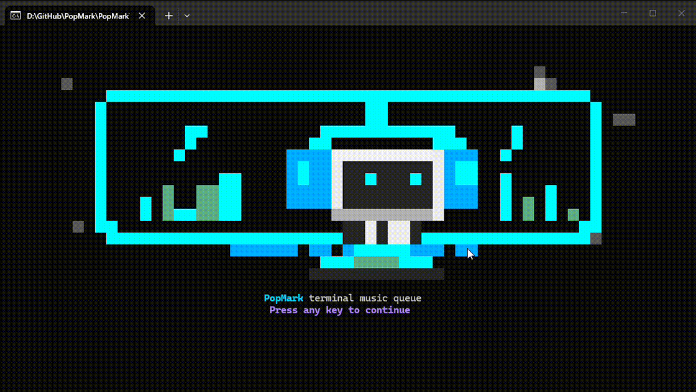

# PopMark

A small terminal music queue for YouTube videos and playlists.

PopMark expands links with `yt-dlp`, streams audio through `mpv`, and keeps your queue available between launches.


## Features

- Add YouTube videos or playlists from the terminal
- Stream through `mpv` without downloading music files
- Restore the previous queue on launch
- A modern OpenTUI + SolidJS interface with panels, dialogs, and mouse support
- Live playback position read from mpv, with seeking, progress, and a volume bar
- Keyboard seeking, clickable queue rows, progress seeking, and a volume bar
- Install local playback tools without admin access

## Demo



## Requirements

- .NET 9 SDK
- Bun 1.3.14 or newer (for the OpenTUI frontend)
- `yt-dlp`
- `mpv`

The OpenTUI frontend reports missing playback tools in the Tools panel (`F2`) and can
install them into the managed folder. The legacy C# UI prompts on first interactive
run. If Bun is not installed, PopMark falls back to that legacy C# terminal UI.

Local tools are stored in `%LOCALAPPDATA%\PopMark\tools`.
Queue state is stored in `%LOCALAPPDATA%\PopMark\queue.json`.
Pinned tool paths are stored in `%LOCALAPPDATA%\PopMark\tools.json`.

### Finding yt-dlp and mpv

PopMark looks for each tool in this order:

1. A path pinned with `tools set` (saved in `tools.json`)
2. The `POPMARK_YTDLP_PATH` / `POPMARK_MPV_PATH` environment variables
3. PopMark's own copy under `%LOCALAPPDATA%\PopMark\tools`
4. `PATH`, plus the usual WinGet, Scoop, and Chocolatey shim folders
5. A scan of the WinGet, Scoop, Chocolatey, and Program Files package folders

That last step covers installs that never landed on `PATH`, such as a WinGet package folder
like `%LOCALAPPDATA%\Microsoft\WinGet\Packages\yt-dlp.yt-dlp_Microsoft.Winget.Source_8wekyb3d8bbwe\yt-dlp.exe`.

Because mpv shells out to yt-dlp itself, PopMark passes the resolved yt-dlp to mpv explicitly
and adds its folder to the PATH the child process inherits. Without that, mpv reports
`youtube-dl failed: not found or not enough permissions` even when PopMark loaded the playlist fine.

Run `tools` at any time to see what PopMark resolved:

```
tools                                       show resolved paths and whether each tool runs
tools install [yt-dlp|mpv|all]              install a private copy under %LOCALAPPDATA%\PopMark\tools
tools set yt-dlp "C:\path\to\yt-dlp.exe"    pin a copy you already have
tools clear yt-dlp                          forget a pinned path
```

`popmark tools` also works from the shell without entering the UI.

If a track will not play, run the non-interactive test and send the output:

```powershell
PopMark.exe play-test "https://www.youtube.com/watch?v=..." --seconds 10
```

It exits with code 3 and prints whatever mpv reported, such as an HTTP 403 from an
out-of-date yt-dlp.

## Run

The C# application launches the OpenTUI frontend automatically when Bun and the `ui/`
sources are available. The C# process stays the playback backend.

```powershell
dotnet run --project .\PopMark\PopMark.csproj
```

Start with a URL:

```powershell
dotnet run --project .\PopMark\PopMark.csproj -- "https://www.youtube.com/watch?v=..."
```

Run the frontend directly (useful while iterating on the UI):

```powershell
cd ui
bun install
bun run start
```

Build the backend first so the frontend can find it:

```powershell
dotnet build .\PopMark.sln --configuration Release
```

Force the legacy C# terminal UI:

```powershell
dotnet run --project .\PopMark\PopMark.csproj -- --legacy-ui
```

Run a short non-interactive playback test:

```powershell
dotnet run --project .\PopMark\PopMark.csproj -- play-test "https://www.youtube.com/watch?v=..." --seconds 15
```

Check the app version:

```powershell
dotnet run --project .\PopMark\PopMark.csproj -- --version
```

### How the UI and backend connect

The frontend spawns `PopMark --bridge` and speaks newline-delimited JSON over
stdin/stdout. Playback, MPV IPC, queue persistence, YouTube resolution, and tool
management stay in C#. See [docs/development.md](docs/development.md) for the protocol
and the frontend structure.

## Versioning

Published builds use semantic versioning from `PopMark/PopMark.csproj`.
Update `Version`, `AssemblyVersion`, `FileVersion`, and `InformationalVersion` together before publishing a release.

## Stack

  - Language: C# for playback, TypeScript for the interface
  - Runtime / Framework: .NET 9, Bun 1.3.14+
  - UI: OpenTUI (`@opentui/core`, `@opentui/solid`) with SolidJS
  - Legacy terminal UI: custom C# renderer retained as a fallback
  - Archive extraction dependency: SharpCompress
  - Playback engine: mpv
  - YouTube metadata / playlist expansion: yt-dlp


## Commands

| Command | Action |
| --- | --- |
| `add <url or search>` | Add a YouTube video, playlist, or search result |
| `play` / `pause` | Toggle playback |
| `goto <#\|title>` | Scroll to a playlist song |
| `shuffle` | Randomize the playlist |
| `tools` | Show resolved playback tool paths, install or pin them |
| `logs` | Open diagnostics and subprocess reports |
| `version` | Show the current app version |
| `clear playlist` | Stop playback and empty the queue |
| `help` | Show keyboard commands and the command reference |
| `splash` / `playlist` | Switch between the focus view and the queue |
| `quit` | Stop playback and exit |

## Controls

New OpenTUI interface:

| Control | Action |
| --- | --- |
| `/` or click the input | Focus the command field |
| `Tab` | Cycle command → navigation → focus view |
| `Esc` | Leave the current input mode, close a dialog, or leave Focus View |
| `Space` | Play/pause in navigation or Focus View mode |
| `n` / `p` | Next or previous track outside command entry |
| `Up` / `Down` | Move the queue selection |
| `Enter` | Play the selected row |
| `Ctrl+P` | Toggle playback from anywhere |
| `Ctrl+N` / `Ctrl+B` | Next or previous track |
| `Ctrl+Left` / `Ctrl+Right` | Seek by 10 seconds |
| `Ctrl+Up` / `Ctrl+Down` | Change volume by 10% |
| `Alt+Left` / `Alt+Right` | Seek by 10 seconds |
| `F1` | Command reference |
| `F2` | Playback tools dialog |
| `F3` | Focus View (large cover, waveform, track info) |
| `F4` | Diagnostics (tool reports and backend output) |
| `Ctrl+Q` | Quit |
| Click a queue row | Play that track |
| Drag or click the progress bar | Seek to that position |
| Drag or click the volume slider | Set the volume |

In Focus View, printable characters are ignored; it is a navigation and playback
surface, not a second command buffer. Tool and installer output is collected in
`F4` diagnostics and never written over the renderer.

Legacy fallback UI (`--legacy-ui`):

| Control | Action |
| --- | --- |
| `Space` | Toggle playback when the command field is empty |
| `-` / `=` | Decrease or increase volume by 10% |
| `Left Arrow` / `Right Arrow` | Seek backward or forward by 10 seconds |
| `Up Arrow` / `Down Arrow` / mouse wheel | Scroll the playlist panel by one row |
| `PageUp` / `PageDown` | Scroll the playlist panel faster |
| `Home` / `End` | Jump to the top or bottom of the playlist |
| Click playlist song | Play that song directly |
| Click progress bar | Jump to that timestamp when the terminal supports mouse input |
