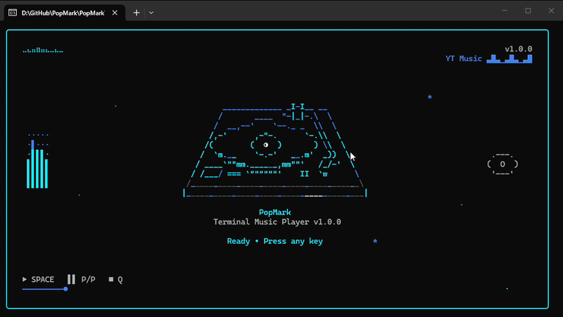

<p align="center">
  
</p>

<p align="center">
  <strong>Your YouTube music queue, in the terminal.</strong><br>
  PopMark expands videos and playlists with <code>yt-dlp</code> and streams the audio
  through <code>mpv</code>, so your music is never downloaded to disk.
</p>

<p align="center">
  <a href="#quick-start">Quick Start</a> ·
  <a href="docs/installation.md">Installation</a> ·
  <a href="docs/configuration.md">Configuration</a> ·
  <a href="docs/user-guide.md">User Guide</a> ·
  <a href="docs/troubleshooting.md">Troubleshooting</a>
</p>

PopMark is a small terminal music queue for YouTube videos and playlists. Paste a link,
or type a search, and it resolves the tracks, keeps them in a queue, and plays them
through `mpv`. The queue survives a restart, and playback continues to the next track
without you touching anything.

## Preview



Adding a 34-track playlist, then seeking and changing the volume by clicking the progress
bar and slider. <kbd>Tab</kbd> switches between this queue view and the splash view.

## Quick Start

**Requirements:** Windows x64 for the released build. Building from source needs the
.NET 9 SDK. `yt-dlp` and `mpv` are installed for you if they are missing; no admin
rights are required.

1. Download the latest `PopMark-v<version>-win-x64.zip` from
   [Releases](https://github.com/markdanielaguinaldo/PopMark/releases) and extract it.
2. Run `PopMark.exe`.
3. On first launch, accept the prompt to install `yt-dlp` and `mpv` into
   `%LOCALAPPDATA%\PopMark\tools`.
4. Add something to the queue:

   ```text
   add https://www.youtube.com/watch?v=...
   add https://www.youtube.com/playlist?list=...
   add lofi hip hop
   ```

5. Press <kbd>Space</kbd> to play or pause, and <kbd>Tab</kbd> to switch views.

To run from source:

```powershell
dotnet run --project .\PopMark\PopMark.csproj
```

See the [installation guide](docs/installation.md) for the released build, local tool
installation, and upgrades.

## Features

- **YouTube queue** — add videos, playlists, or a search result from the terminal.
- **No downloads** — audio is streamed through `mpv`; PopMark keeps a queue, not a music
  library.
- **Queue restore** — the current track, upcoming tracks, and volume come back on the
  next launch.
- **Keyboard and mouse** — seek, volume, scroll, and click a playlist row to play it.
- **Splash and playlist views** — <kbd>Tab</kbd> flips between the splash art and the queue.
- **Clear failure reporting** — a track that dies on start says why, and `play-test`
  reproduces the problem outside the UI.
- **Local tool install** — `yt-dlp` and `mpv` can live in PopMark's own folder, so no
  admin access or system-wide install is needed.
- **Tool discovery** — pinned paths, environment variables, and `PATH` first, then the
  WinGet, Scoop, Chocolatey, and Program Files folders.

## Documentation

| Guide | Contents |
| --- | --- |
| [Installation](docs/installation.md) | Requirements, released build, building from source, first run, upgrades |
| [Configuration](docs/configuration.md) | Tool discovery, pinned paths, environment variables, state files, volume |
| [User Guide](docs/user-guide.md) | Adding music, views, commands, keyboard and mouse controls, queue restore |
| [Troubleshooting](docs/troubleshooting.md) | Missing tools, 403 errors, failed playback, stale sessions, exit codes |
| [Development](docs/development.md) | Project layout, architecture, build and release flow, commit conventions |

## Privacy and local state

PopMark has no account system and no telemetry. It talks to YouTube through `yt-dlp`
and to GitHub when it installs or updates a tool. Everything it remembers lives under
`%LOCALAPPDATA%\PopMark`:

| File | Contents |
| --- | --- |
| `queue.json` | Current track, previous and upcoming tracks, volume |
| `tools.json` | Pinned `yt-dlp` and `mpv` paths |
| `sessions.json` | Live `mpv` processes, used to clean up after a crash |
| `tools\` | Tools installed by PopMark itself |

Deleting that folder resets PopMark completely. Nothing is written next to the
executable, so an extracted release can be removed by deleting its folder.
